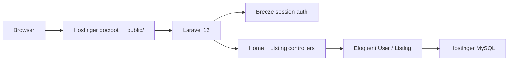

# Migrate GigsWP to Laravel 12 (MySQL + Hostinger)

Rebuild the custom PHP MVC job board as a greenfield Laravel 12 app with MySQL, Breeze Blade auth, and Hostinger Business shared-hosting deploy (SSH + document root → `public/`). Ownership policies are deferred but the data model stays ready for them.

## Context

This is **not** WordPress. It is a small custom PHP MVC job board (~1.4k LOC) with a hand-rolled router, PDO, and PHP views. Migration means a **greenfield Laravel rebuild** that reuses the same MySQL schema/data and URL paths — not wrapping `Framework\`.

**Locked decisions**
- Stack: **Laravel 12 + PHP 8.3**, `DB_CONNECTION=mysql`
- Auth: **Laravel Breeze (Blade + Tailwind)** — login, register, logout, password reset
- Auth stretch (now): **no ownership policies** yet; create/edit/delete require auth, any logged-in user can mutate any listing
- Deploy: **Hostinger Business shared hosting** (SSH + FTP/SFTP)

**Can Breeze change later?** Yes. Breeze copies auth controllers, routes, and Blade views into *your* app. You own that code. Later you can:
- Add a `ListingPolicy` and `authorize()` without replacing Breeze
- Add Spatie roles/permissions on top of the same `User` model
- Swap UI (Inertia/React/Vue) or move to Fortify/Jetstream if needed

Choosing Breeze now does **not** lock you into a dead-end auth architecture.

---

## Target architecture



| Current | Laravel |
|---|---|
| `routes.php` + `Framework/Router.php` | `routes/web.php` + `routes/auth.php` |
| `Framework/Database.php` PDO | Eloquent + query builder |
| `Framework/Validation.php` | Form Request classes |
| `App/views/*.view.php` | Blade views (port markup; Breeze supplies auth/layout) |
| `config/db.php` credentials | `.env` (`DB_*`) — never commit secrets |
| `user_id = 1` hardcoded | `auth()->id()` when creating listings |
| Playwright smoke test | Keep/adapt against Laravel URLs |

Keep existing public URLs: `/`, `/listings`, `/listings/{id}`, `/listings/create`, `/listings/edit/{id}`, and map Breeze auth to `/login`, `/register` (or keep `/auth/*` via route aliases if you want zero URL churn).

---

## Phase 1 — Scaffold Laravel in this repo

1. Create a fresh Laravel 12 app (temp dir or branch), then bring it into this repo so git history continues.
2. Set `.env` for local MySQL; remove reliance on `config/db.php`.
3. Install Breeze Blade:
   - `composer require laravel/breeze --dev`
   - `php artisan breeze:install blade`
   - `npm install && npm run build`
4. Drop/replace custom `Framework/`, old front controller wiring, and old `App/controllers` once Laravel equivalents exist (do not keep two routers).
5. Port static assets: `public/css/style.css`, `public/images/` — either keep the existing CSS for listing pages or gradually unify with Breeze’s Tailwind. Prefer **one Tailwind pipeline** (Vite) so Hostinger only needs built assets in `public/build`.

---

## Phase 2 — Schema & data (MySQL)

Existing tables inferred from controllers:

- **`users`**: `name`, `email`, `city`, `state`, `password` (already `password_hash` / bcrypt — **compatible with Laravel**; no WP phpass migration needed)
- **`listings`**: title, description, salary, requirements, benefits, tags, company, address, city, state, phone, email, `user_id`

Approach (best practice for an existing DB):

1. Write Laravel migrations that **match** the live schema (or use `php artisan schema:dump` / inspect via SSH/`SHOW CREATE TABLE` on the current DB).
2. Extend Breeze’s `users` migration with `city` and `state` (nullable or required to match current register form).
3. Add `listings` migration with `foreignId('user_id')->constrained()->cascadeOnDelete()` (or `nullOnDelete` if you prefer keeping orphaned jobs).
4. Add Breeze extras Laravel expects: `password_reset_tokens`, `sessions` (if database sessions), `cache`, `jobs` as needed — even if shared hosting won’t run queue workers.
5. **Data cutover**: point Laravel `.env` at the same MySQL database (local first, then Hostinger). Prefer migrate-on-empty-DB + optional one-time import script if production already has rows; validate row counts for `users` and `listings`.

Models:
- `User` — fillable: name, email, city, state, password; `hasMany(Listing::class)`
- `Listing` — fillable matching form fields; `belongsTo(User::class)`

---

## Phase 3 — Features port

**Routes / controllers**
- `HomeController@index` — latest 6 listings
- Resource-style `ListingController` — index, create, store, show, edit, update, destroy
- Form Requests for store/update (required: title, description, salary, city, state, email)
- Flash success messages via Laravel session (`->with('success', ...)`)
- 404 via `abort(404)` / model binding

**Auth behavior for this migration**
- Breeze: register (include city/state on register form + `RegisteredUserController`), login, logout, password reset UI
- Protect **create/store/edit/update/destroy** with `auth` middleware (upgrade from today’s fully open mutations)
- **Skip** `ListingPolicy` for now — any logged-in user can edit/delete any listing
- On `store`, set `user_id` to `auth()->id()` (fixes hardcoded `1`; enables policies later with no schema change)

**Views**
- Port home, listings index/show/create/edit, partials (navbar, banners, search bar) to Blade
- Wire navbar to `auth()->check()`, `@csrf`, `@method('PUT'|'DELETE')`
- Search form on home remains UI-only unless you explicitly want a `listings?search=` filter in this pass (out of core parity unless requested)

**Health**
- Replace `public/health.php` with a simple Laravel route or keep a thin public script if you use it for uptime checks

**Tests**
- Update Playwright selectors/URLs for Breeze auth pages; keep one smoke path (home → listings → show)

---

## Phase 4 — Hostinger Business deploy

Hostinger Business gives SSH + ability to set document root — use that.

**Recommended layout**
- App lives at e.g. `~/domains/yourdomain.com/laravel/` (or home dir sibling)
- In hPanel → Domains → set document root to `.../laravel/public` (preferred over copying `public/` into `public_html`)
- Fallback only if needed: root `.htaccess` rewrite into `public/`

**Production `.env`**
```
APP_ENV=production
APP_DEBUG=false
APP_URL=https://your-domain
DB_CONNECTION=mysql
DB_HOST=localhost   # Hostinger MySQL host from hPanel
DB_DATABASE=...
DB_USERNAME=...
DB_PASSWORD=...
SESSION_DRIVER=file
CACHE_STORE=file
QUEUE_CONNECTION=sync
```

**Deploy steps (SSH)**
1. Create MySQL DB/user in hPanel; import or migrate
2. Upload/rsync app (exclude `.env`, `node_modules`; include `vendor` **or** run Composer on server)
3. If `composer install` OOMs on shared hosting: build `vendor` locally/CI, upload zip, unzip on server
4. `php artisan key:generate` (once), `migrate --force`, `storage:link`, `config:cache`, `route:cache`, `view:cache`
5. `npm run build` locally/CI; deploy `public/build` (no Node required on Hostinger)
6. Ensure `storage/` and `bootstrap/cache/` are writable
7. Confirm `/.env` is not web-accessible; `APP_DEBUG=false`

**Shared-hosting constraints to respect**
- No reliable long-running queue/Horizon workers → keep `QUEUE_CONNECTION=sync`
- No Redis assumed → file sessions/cache
- Prefer FTP/SFTP + SSH artisan over running heavy builds on the server

---

## Phase 5 — Cutover checklist

- [ ] Local: register/login/logout, CRUD listings, flash messages, CSRF
- [ ] Existing bcrypt users can log in (spot-check)
- [ ] Staging on Hostinger subdomain with production-like `.env`
- [ ] Document root → `public/`; HTTPS on
- [ ] Playwright smoke green against staging URL
- [ ] DNS/cutover; monitor 404s for `/auth/*` vs `/login` if paths changed

---

## Explicitly out of scope (easy later)

- `ListingPolicy` / ownership enforcement
- Roles (Spatie), email verification enforcement beyond Breeze defaults you enable
- Listing search backend
- Queues, Redis, Nova admin
- WordPress-style content import (N/A — not WP)

---

## Implementation todos

1. Scaffold Laravel 12 in-repo; install Breeze Blade; Vite/Tailwind; MySQL `.env`
2. Write migrations/models for users (`city`/`state`) + listings; verify bcrypt login on existing data
3. Port home + listings CRUD to controllers, Form Requests, Blade; auth middleware; `auth()->id()` on create
4. Extend Breeze register for city/state; wire navbar auth links; keep URLs or alias `/auth/*`
5. Document/deploy Hostinger Business: docroot→`public`, `.env`, migrate, caches, built assets
6. Remove `Framework/` old MVC; update README + Playwright smoke

## Suggested implementation order

1. Scaffold Laravel 12 + Breeze Blade + MySQL `.env`
2. Migrations/models matching `users` + `listings`; seed or import
3. Port listing + home controllers/views; auth middleware on mutations
4. Extend Breeze register for `city`/`state`
5. Hostinger deploy docs + first staging deploy
6. Retire old `Framework/` and custom entrypoint; update README + Playwright
